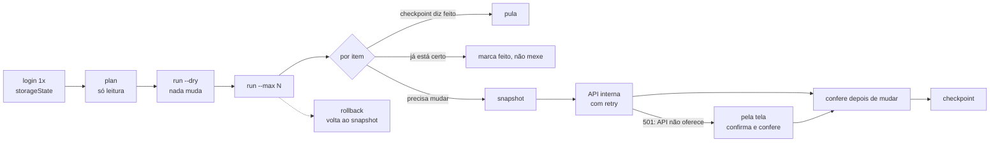

# playwright-safe-batch

Automação web **em massa** com Playwright, sem medo de rodar: plano antes, simulação, checkpoint
idempotente, snapshot para desfazer, retry que separa erro transitório de erro de negócio e evidência de cada falha.
Node + TypeScript, com um mini-SaaS falso no próprio repo para testar sem tocar em nada real.

## O problema

Sistemas sem API pública (ou com API incompleta) costumam virar "script que clica" quando é preciso
mudar centenas de registros. Aí aparecem os problemas de verdade:

- o script cai no item 137 e ninguém sabe o que já foi feito: rodar de novo **duplica** ou **pula** coisas;
- uma instabilidade de 30 segundos (503, 429) derruba o lote inteiro, ou pior, vira "falha" de item que estava certo;
- não existe "desfazer": se a regra estava errada, alguém conserta tudo na mão;
- quando algo dá errado, não há evidência do que a tela ou a API mostraram.

## A solução



- **Sessão uma vez.** Login pela tela, `storageState` salvo fora do git e reaproveitado. Se a sessão vence no meio do lote, faz login de novo e segue.
- **API que o próprio front usa**, chamada de dentro do contexto autenticado (`context.request`). Mesmos cookies, nada de senha no código. Cliente tipado.
- **Plano → simulação → execução.** `plan` só lê; `run --dry` mostra o que mudaria; `run --max 5` testa com poucos itens antes do lote todo.
- **Checkpoint idempotente** em JSONL. Rodar de novo pula o que foi feito e retenta só o que falhou.
- **Lê antes de escrever, confere depois.** Item que já está certo não é tocado; depois de mudar, relê para confirmar.
- **Retry com classificação.** `503`, `429` (respeita `Retry-After`) e erro de rede tentam de novo com espera exponencial e jitter. `409`, `404` e outras regras de negócio registram e seguem. Sessão inválida para o lote. **5 falhas transitórias seguidas param o lote** (o sistema alvo está com problema; insistir só piora).
- **Caminho pela tela** quando a API não oferece a operação: abre a página, clica, confirma o diálogo, confere o status.
- **Snapshot e rollback.** O estado antes de cada mudança fica em JSONL; `rollback` volta tudo (também idempotente) e libera o item para ser refeito.
- **Evidência de falha.** Pela tela: print e HTML. Pela API: a resposta de erro em JSON (sem cookies).
- **Ritmo controlado** (`THROTTLE_MS`) e **relatório CSV** por execução (com BOM para o Excel e proteção contra fórmula).

## Demo

O [mini-SaaS falso](fake-saas/server.ts) tem 200 projetos sintéticos com integrações. A tarefa do exemplo:
**desconectar todas as integrações `legacy-ftp`**. O servidor da demo liga caos de propósito:
10% de `503`, um `429` a cada 25 chamadas e alguns projetos travados (`409`).

```text
$ npm run fake-saas
mini-SaaS falso em http://127.0.0.1:3000 (usuário demo / senha demo)

$ npm run batch -- plan
plano: 78 integração(ões) para desconectar → runs/plan.json

$ npm run batch -- run --dry
simulação (nada foi alterado): 0 feito(s) · 0 já certo(s) · 0 pulado(s) pelo checkpoint · 78 mudaria(m) · 0 falha(s)

$ npm run batch -- run --max 5
✓ p001:p001-i3 desconectada (via api)
  ↻ tentativa 2 em 1000 ms (project.get: muitas requisições (HTTP 429))
✓ p003:p003-i1 desconectada (via api)
✓ p006:p006-i3 desconectada (via api)
✓ p008:p008-i2 desconectada (via api)
✓ p010:p010-i4 desconectada (via api)
execução: 5 feito(s) · 0 já certo(s) · 0 pulado(s) pelo checkpoint · 0 mudaria(m) · 0 falha(s)

$ npm run batch -- run
execução: 72 feito(s) · 0 já certo(s) · 5 pulado(s) pelo checkpoint · 0 mudaria(m) · 1 falha(s)
  ✗ p037:p037-i1: integration.disconnect: projeto travado para alterações (HTTP 409)

$ npm run batch -- run          # de novo: nada é refeito
execução: 0 feito(s) · 0 já certo(s) · 77 pulado(s) pelo checkpoint · 0 mudaria(m) · 1 falha(s)

$ npm run batch -- rollback
rollback: 77 feito(s) · 1 já certo(s) · 0 pulado(s) pelo checkpoint · 0 mudaria(m) · 0 falha(s)
```

Evidência da falha (`runs/evidence/p037_p037-i1.json`):

```json
{ "key": "p037:p037-i1", "error": "BusinessError", "code": "locked", "status": 409,
  "message": "integration.disconnect: projeto travado para alterações (HTTP 409)" }
```

**Quando a API não oferece a operação** (`FAKE_RPC_DISCONNECT=off`), o mesmo comando segue pela tela:

```text
$ npm run batch -- run --max 3
✓ p001:p001-i3 desconectada (via ui)
✓ p003:p003-i1 desconectada (via ui)
✓ p006:p006-i3 desconectada (via ui)
```

### Rodar

```bash
git clone https://github.com/reanto-afk/playwright-safe-batch && cd playwright-safe-batch
npm install && npx playwright install chromium
cp .env.example .env
npm run fake-saas                                   # num terminal
node --env-file=.env --import tsx src/cli.ts plan   # noutro (ou: npm run batch -- plan, com as variáveis no ambiente)
node --env-file=.env --import tsx src/cli.ts run --dry
```

`HEADLESS=false` mostra o navegador; `FAKE_RPC_DISCONNECT=off` força o caminho pela tela.

## Adaptar para outro sistema

| Arquivo | O que trocar |
|---------|--------------|
| [`src/session.ts`](src/session.ts) | seletores do login |
| [`src/client.ts`](src/client.ts) | métodos da API interna (descubra pelo DevTools → Network) |
| [`src/ui.ts`](src/ui.ts) | o caminho pela tela, com leitura antes e conferência depois |
| [`src/batch.ts`](src/batch.ts) | `plan` (quem são os alvos) e a mudança por item |

O resto (retry, checkpoint, snapshot, rollback, evidência, relatório, CLI) não muda.

## Decisões de design

- **API do front antes da tela.** É mais rápida e estável que clicar; a tela fica como plano B e para o que só existe nela.
- **Erro de negócio não é retentado.** Insistir num `409` só gera ruído no sistema alvo e no log.
- **Checkpoint por item, gravado na hora.** O processo pode morrer a qualquer momento sem perder o que já foi feito.
- **Disjuntor de falhas transitórias.** Se o alvo está fora do ar, parar é mais seguro que marcar 500 itens como falha.
- **Snapshot é anexado, nunca sobrescrito.** O primeiro registro de cada item é o estado original, mesmo depois de várias execuções.

## Limites

- O caminho pela tela depende de seletores; mudou a tela, ajuste [`src/ui.ts`](src/ui.ts). O `verify` depois de cada mudança pega a quebra em vez de seguir no escuro.
- Uma sessão por vez: o lote é sequencial de propósito (ritmo controlado e checkpoint simples).
- Antes de usar num sistema de terceiro, confira os termos de uso dele e prefira a API oficial quando existir.

## Testes

```bash
npm run typecheck && npm test
```

15 testes (Vitest): retry, ritmo, checkpoint, snapshot e CSV, mais testes ponta a ponta com Chromium de verdade contra o SaaS falso com caos ligado. Cobrem: plano, simulação sem mutação, execução, reexecução idempotente, rollback e refazer depois dele, `--max`, caminho pela tela, evidência, sessão vencida no meio, disjuntor e senha errada.

## Licença

MIT
